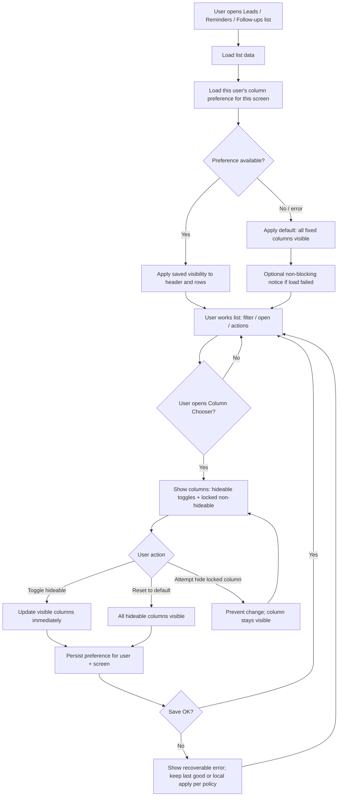

# Requirements Brief: Column Visibility / Column Chooser

**Product:** Aadi CRM (`aaditech-auth`)  
**Feature:** Per-user column show/hide on Leads, Reminders, and Follow-ups list screens  
**Status:** Draft for Architect Handoff  
**Date:** 2026-11-01

---

## 1. Summary

Sales users working Leads, Reminders, and Follow-ups today see a fixed set of columns on each list. There is no way for a user to choose which columns stay visible. That forces everyone into the same dense desktop grid even when they only need a few fields (for example, Lead + Due + Actions on Reminders).

**Goal:** Let each signed-in user open a column chooser on those three list screens, check/uncheck which columns to show, and have that preference apply immediately and persist across sessions — without breaking row identity (Lead name) or essential row actions, and without changing the existing Lead Fields admin `show_in_list` subtitle behavior on Leads for MVP.

**Current behavior (observed):**
- **Leads** list: fixed columns Lead, Status, Priority, Follow-up, Source, plus an open action. Desktop uses a CSS grid header; on small screens columns stack under the Lead cell. Up to three custom fields flagged `show_in_list` appear as a subtitle under the Lead cell only (not as separate columns). Reminders and Follow-ups ignore `show_in_list`.
- **Reminders** list: fixed columns Checkbox, Lead, Plan, Priority, Due, Status, Actions. Rows are lead-centric (leads that have a next follow-up).
- **Follow-ups** list: fixed columns Lead, Plan, Priority, Due, Actions. Same lead data, plan-step oriented workflow.
- No per-user column visibility preference exists today.

---

## 2. Clarifying Questions

| # | Question | Default assumption | Who answers |
|---|---|---|---|
| Q1 | Should column visibility be **per screen** (Leads vs Reminders vs Follow-ups separately) or one shared preference across all three? | **Per screen** — each list has its own chooser and saved set. | Product owner / stakeholder |
| Q2 | Should preferences be **per user only**, or also allow a company-wide default that new users inherit? | **Per user only** for MVP; new users see all current fixed columns until they change. | Product owner |
| Q3 | May the user hide **Status / Priority / Due / Source / Plan** freely, as long as Lead identity and essential Actions (and Reminders Checkbox for bulk select) remain? | Yes — only Lead name/identity column and essential Actions (plus Reminders selection Checkbox) are non-hideable. | Product owner |
| Q4 | On mobile / narrow layout (where columns already stack), should the chooser still apply, or only affect the desktop grid header layout? | Chooser applies wherever those column cells are rendered; mobile layout must remain usable and not break. | Product owner + UX |
| Q5 | If preference load fails (offline / error), should the list fall back to **all columns visible** without blocking the screen? | Yes — show full default columns and optionally a non-blocking notice; do not block listing. | Product owner |
| Q6 | Should “Reset to default” (all hideable columns on again) be in MVP? | **Yes** — Should priority; include a clear reset control in the chooser. | Product owner |
| Q7 | After MVP, should custom Lead Fields (`show_in_list`) become full chooser columns on Leads (and possibly other screens)? | **Out of scope for MVP**; keep subtitle under Lead on Leads only. Capture as future enhancement. | Product owner |

---

## 3. Scope

### In scope (MVP)
- Column chooser UI entry point on **Leads**, **Reminders**, and **Follow-ups** list screens.
- User can show/hide the **existing fixed columns** for that screen (check = visible, unchecked = hidden).
- Preference is **per signed-in user**, **per list screen**, and **persists across sessions**.
- Non-hideable columns: Lead identity (name / primary Lead cell) and essential row Actions; on Reminders, the row selection Checkbox remains available for bulk actions.
- Immediate apply: list updates when the user confirms or toggles visibility (Assumption: apply on each toggle or on Apply — see Q; default: apply on toggle for responsiveness).
- Reset to default (all currently defined hideable columns visible again).
- Desktop grid is primary; mobile must not break when columns are hidden.

### Out of scope (MVP)
- Column **reorder**, resize, pin/freeze, or density modes.
- Turning custom Lead Fields (`show_in_list`) into separate chooser columns; changing admin field config.
- Column chooser on any other screens (Projects, Users, Reports, drawers, dialogs, import mapping).
- Company-wide / role-based mandatory column sets (beyond non-hideable rules above).
- Export / print layout driven by column chooser.
- Shared or team-published column presets.
- Changing which data is fetched solely because a column is hidden (Assumption: hiding is presentation-only for MVP).

### Current columns by screen (chooser candidates)

| Screen | Fixed columns today | Non-hideable (MVP assumption) | Hideable |
|---|---|---|---|
| Leads | Lead, Status, Priority, Follow-up, Source, Open action | Lead, Open action | Status, Priority, Follow-up, Source |
| Reminders | Checkbox, Lead, Plan, Priority, Due, Status, Actions | Checkbox, Lead, Actions | Plan, Priority, Due, Status |
| Follow-ups | Lead, Plan, Priority, Due, Actions | Lead, Actions | Plan, Priority, Due |

**Assumption:** Custom `show_in_list` subtitles on Leads remain as today and are not part of the chooser checklist.

---

## 4. Roles

| Role | Relevance to this feature |
|---|---|
| **Signed-in CRM user** (e.g. Salesperson, Business Owner, or any role that can open these lists) | Opens chooser, selects columns, sees personal preference applied on that screen. |
| **Admin / Lead Fields manager** | Unchanged for MVP; still configures `show_in_list` for Lead subtitles only — not the column chooser. |
| **Unauthenticated visitor** | No access; feature only after sign-in on app list screens. |

**Assumption:** Any user who can view a given list screen may customize columns for themselves on that screen. No new permission is required for MVP.

---

## 5. Functional Requirements

FR-1: The system shall provide a Column Chooser control on the Leads, Reminders, and Follow-ups list screens when the signed-in user can view that screen.

FR-2: The system shall list, in the chooser, the fixed columns defined for that screen and allow the user to mark each hideable column as visible or hidden.

FR-3: The system shall prevent the user from hiding non-hideable columns (Lead identity; essential Actions; Reminders selection Checkbox) and shall present those columns as always visible / locked in the chooser.

FR-4: The system shall update the list header and row cells so that only columns marked visible (plus non-hideable columns) are shown, without removing row data from the underlying list.

FR-5: The system shall store the signed-in user’s column visibility preference **per list screen** and restore it on later visits to that screen.

FR-6: The system shall not share one user’s column preference with another user.

FR-7: The system shall leave Lead Fields `show_in_list` subtitle rendering on the Leads Lead cell unchanged by the column chooser for MVP.

FR-8: The system shall offer a Reset-to-default action that restores all hideable columns for that screen to visible.

FR-9: The system shall, when preference load fails, display the screen’s default full column set and still allow listing and chooser use (no hard block of the list).

FR-10: The system shall keep filters, search, sorting, pagination, bulk selection (Reminders), and row actions available regardless of which hideable columns are hidden.

FR-11: The system shall not apply Leads column preferences to Reminders or Follow-ups (and vice versa); preferences are independent per screen.

---

## 6. Non-Functional Requirements

NFR-1 (usability): A user who can use the list today shall discover and complete a column show/hide change in under 30 seconds without training documentation.

NFR-2 (performance): Applying a column visibility change shall update the visible list layout within 1 second on a typical desktop session after the user toggles (excluding first-time preference network latency if any). **Assumption:** layout update is client-side once preference is known.

NFR-3 (reliability): Preference save failure shall not corrupt list data; the UI shall keep the last successfully applied visibility or fall back to defaults and show a clear recoverable message.

NFR-4 (usability / responsive): On narrow / mobile layouts, hiding columns shall not break scrolling, tap targets for Actions, or Lead identity readability.

NFR-5 (security / privacy): Column preferences are scoped to the authenticated user; one user must not read or write another user’s preferences.

NFR-6 (compatibility): Existing list behaviors (open lead, call outcomes, snooze, filters) remain available after column customization; no regression of those actions for users who never open the chooser (default = all current columns visible).

---

## 7. User Stories

US-1 (Priority: Must) - Covers: FR-1, FR-2, FR-3, FR-4  
As a signed-in CRM user,  
I want to open a column chooser on Leads / Reminders / Follow-ups and check which hideable columns to show,  
So that my list shows only the columns I need for that day’s work.

US-2 (Priority: Must) - Covers: FR-5, FR-6, FR-11  
As a signed-in CRM user,  
I want my column choices for each list to come back after I sign out and return,  
So that I do not reconfigure the same screen every session.

US-3 (Priority: Must) - Covers: FR-3, FR-10  
As a signed-in CRM user,  
I want Lead identity and essential Actions (and Reminders selection) to always stay available,  
So that I can still identify rows and complete follow-up work even if I hide other columns.

US-4 (Priority: Should) - Covers: FR-8  
As a signed-in CRM user,  
I want to reset a screen’s columns to the default full set,  
So that I can recover quickly if I hide too much.

US-5 (Priority: Must) - Covers: FR-7, FR-9, NFR-4, NFR-6  
As a signed-in CRM user,  
I want the list to keep working (including mobile layout and existing Lead subtitles) even if preferences fail to load or I hide several columns,  
So that column customization never blocks my core lead workflow.

---

## 8. Acceptance Criteria

AC-1 (for US-1)  
Happy path:  
  Given I am signed in and viewing the Reminders list with all default columns  
  When I open the Column Chooser, uncheck Priority and Status, and confirm/apply  
  Then the Reminders header and rows no longer show Priority or Status cells, while Checkbox, Lead, and Actions remain visible.  
Unhappy path:  
  Given I open the Column Chooser on Reminders  
  When I attempt to uncheck Lead (or Actions / Checkbox)  
  Then the control remains checked/disabled and those columns stay visible; no error that blocks the dialog.

AC-2 (for US-1)  
Happy path:  
  Given I am on the Leads list  
  When I hide Source and Follow-up via the chooser  
  Then Status and Priority (if still checked) and Lead + Open action still render, and hidden columns do not appear in the desktop header.  
Unhappy path:  
  Given I hide every hideable column on Leads  
  When the list refreshes  
  Then Lead identity and Open action remain; the row is still usable.

AC-3 (for US-2)  
Happy path:  
  Given I saved a custom column set on Follow-ups (e.g. Plan hidden)  
  When I leave the app and later open Follow-ups as the same user  
  Then Plan remains hidden and my other choices match what I saved.  
Unhappy path:  
  Given another user opens Follow-ups on the same company  
  When they view the list  
  Then they see their own preference (or defaults), not mine.

AC-4 (for US-2 / FR-11)  
Happy path:  
  Given I hid Source on Leads only  
  When I open Reminders  
  Then Reminders still shows its own columns per its preference/default (Leads hide does not remove Reminders columns).  
Unhappy path:  
  Given preference for Leads fails to save  
  When I reopen Leads  
  Then I see either the last successfully saved set or the full default set, with a clear message if save failed — not a blank or broken grid.

AC-5 (for US-3)  
Happy path:  
  Given hideable columns are hidden on Follow-ups  
  When I use Connected / No answer / Snooze / Skip on a row  
  Then those actions still work as before.  
Unhappy path:  
  Given I have no permission to update leads  
  When columns are customized  
  Then Actions that were previously unavailable remain unavailable; column visibility does not grant new permissions.

AC-6 (for US-4)  
Happy path:  
  Given I have hidden multiple columns on a screen  
  When I choose Reset to default in the chooser  
  Then all hideable columns for that screen become visible again and the preference is saved as default.  
Unhappy path:  
  Given Reset is triggered but save fails  
  When the chooser closes or retries  
  Then I see an error/notice; list either keeps showing the reset layout locally with a retry path or reverts consistently — never a partial corrupt mix without explanation. **Assumption:** product prefers showing reset layout locally with retry; architect confirms.

AC-7 (for US-5)  
Happy path:  
  Given Leads has custom fields with `show_in_list`  
  When I hide Status via the chooser  
  Then the custom-field subtitle under Lead still appears as today (unchanged by chooser).  
Unhappy path:  
  Given preference cannot be loaded on mobile  
  When the list renders  
  Then default columns show, Lead and Actions remain usable, and layout does not clip essential controls off-screen.

---

## 9. Process Flow

---

## 10. Assumptions & Risks

### Assumptions
1. Preference is **per user** and **persists across sessions**.
2. MVP scope is **only** Leads, Reminders, and Follow-ups list screens.
3. At least **Lead name/identity** and **essential row actions** cannot be fully hidden; Reminders **Checkbox** also stays.
4. Custom `show_in_list` fields stay as **Lead subtitle on Leads only** for MVP; chooser toggles **existing fixed columns** primarily.
5. **Desktop grid is primary**; mobile must not break.
6. Preferences are **independent per screen** (Q1 default).
7. Hiding columns is **presentation-only** for MVP (does not change which leads are returned).
8. No new permission is required; list viewers may customize their own columns.
9. Default for users with no saved preference = **all current fixed columns visible** (today’s behavior).

### Risks
| Risk | Impact | Mitigation |
|---|---|---|
| Users hide Due/Priority and miss urgency cues | Missed follow-ups | Non-hideable Lead + Actions; Reset; optional later “recommended columns” guidance |
| Mobile stacked layout vs desktop grid diverge when columns hidden | Confusing or broken UI | Explicit AC for narrow layout; keep Lead + Actions always |
| Confusion with Lead Fields `show_in_list` | Users expect custom fields in chooser | Document out of scope; keep subtitle behavior; Q7 for phase 2 |
| Preference save/load failure | Frustration / inconsistent columns | FR-9, NFR-3, AC unhappy paths with fallback |
| Independent preferences per screen feel “wrong” if users expect one global set | Support noise | Confirm Q1; document in release notes |

---

## 11. Architect Handoff

### Architect Handoff
- **Entities:**
  - **User** (identity of preference owner)
  - **List screen** (enum-like: Leads | Reminders | Follow-ups)
  - **Column definition** (stable column key, display label, hideable flag, screen)
  - **Column visibility preference** (user + screen + map of column key → visible; timestamps as needed)
  - **Lead** (unchanged; list rows remain lead-centric on all three screens)
  - **Lead Field** (`show_in_list` — unchanged; subtitle only on Leads; not chooser columns in MVP)
- **Roles & permissions:**
  - Any authenticated user who can view the list: read/update **own** column preferences for that screen
  - No cross-user preference access
  - Existing lead action permissions unchanged by this feature
- **Constraints:**
  - Stay in problem space for design; respect existing three list UIs and fixed column sets
  - Non-hideable: Lead identity, essential Actions; Reminders Checkbox
  - Do not change `show_in_list` admin semantics in MVP
  - Mobile must remain usable
  - Preference persistence required across sessions
- **Scale:** Assumption: tens to low hundreds of users per company; preference payload is small (few boolean flags per screen); list row counts unchanged by this feature
- **Integrations:** None external for MVP (no third-party grid products assumed)
- **Traceability:** FR-1..FR-11, NFR-1..NFR-6, US-1..US-5, AC-1..AC-7
- **Open questions:** Q1–Q7 in Clarifying Questions (owners: Product owner; Q4 also UX)

---

*End of Requirements Brief*
