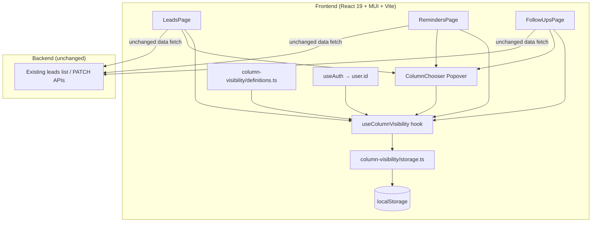
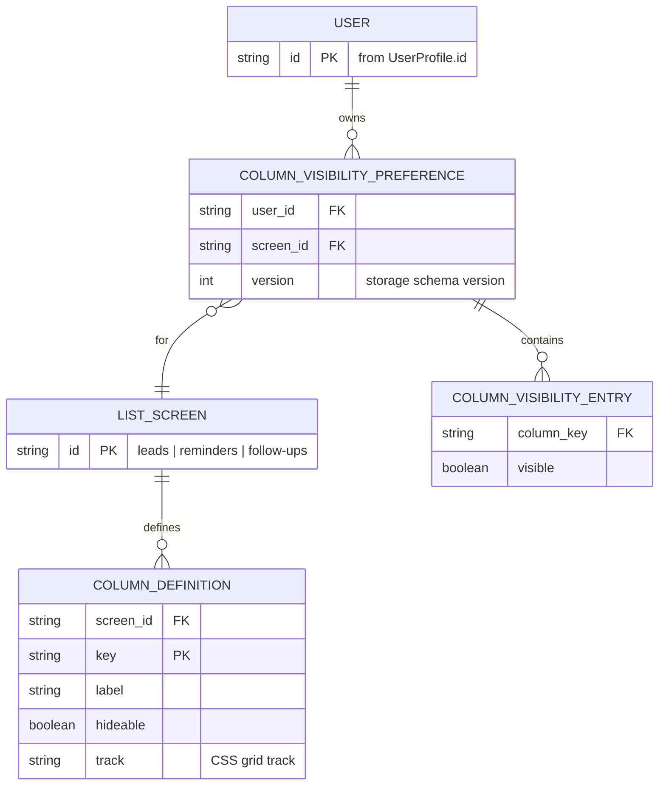

# Technical Design — Column Visibility (Aadi CRM)

**Product:** Aadi CRM (`aaditech-auth`)  
**Feature:** Per-user, per-screen column show/hide on Leads, Reminders, Follow-ups  
**Status:** Ready for implementation  
**Date:** 2026-11-01  
**Requirements:** `01-requirements-brief-column-visibility.md`  
**Confirmed decisions:** Q1 = per screen; Q2–Q7 = brief defaults (per user only; Lead/Actions/Checkbox locked; chooser on mobile; load-fail → defaults; Reset in MVP; custom fields out of MVP)

---

## 1. Design Summary

Add a **Column Chooser** on Leads, Reminders, and Follow-ups so each signed-in user can show/hide that screen’s hideable columns. Preferences are **per user + per screen**, apply immediately on toggle, and persist across sessions.

| Decision | Choice | Why |
|---|---|---|
| Persistence | **Client `localStorage` keyed by `userId` + screen** | Meets FR-5/6/11 and NFR-2/5 with zero backend work; mirrors existing `followup-plan/plan.ts` pattern |
| Server API / DB | **None for MVP** | No user-preferences API exists today (verified); payload is tiny booleans; presentation-only |
| Column catalog | **Frontend constants** per screen (stable keys, labels, hideable, CSS track) | Lists already hardcode CSS grids; keep single source of truth next to grid logic |
| UI | Shared **MUI `Popover` + `FormControlLabel`/`Checkbox`** + Reset | Matches existing MUI Menu/Dialog/checkbox patterns; discoverable in &lt;30s (NFR-1) |
| Apply model | **Toggle applies immediately**; persist after each change | Matches brief default; layout update is sync (NFR-2) |
| Failure policy | Corrupt/missing/unavailable storage → **full default columns**; save fail → keep local apply + non-blocking notice | FR-9, NFR-3, AC-4/6 |
| Locked columns | Force-visible on load and save | Lead + Actions (+ Reminders Checkbox); FR-3 |

**Assumption:** MVP scale is tens to low hundreds of users per company; preference payload is a few boolean flags per screen; list fetch/pagination unchanged (hiding is presentation-only).

**Trade-off accepted:** Preferences do **not** sync across browsers/devices in MVP. Cross-device sync requires a later preferences API (see Risks).

---

## 2. Architecture Overview

Frontend-only feature layered onto the three existing list pages. No new FastAPI routes or PostgreSQL tables for MVP.



**Component responsibilities**

| Piece | Responsibility | Covers |
|---|---|---|
| `definitions.ts` | Per-screen column keys, labels, `hideable`, default CSS `track` widths | FR-2, FR-3, FR-7 (excludes custom fields) |
| `storage.ts` | `load` / `save` / `reset` with versioned keys, parse validation, fallbacks | FR-5, FR-6, FR-8, FR-9, FR-11, NFR-3, NFR-5 |
| `useColumnVisibility(screen)` | React state; merge locked columns; expose `visible`, `setVisible`, `reset`, `buildGridTemplate` | FR-4, NFR-2 |
| `ColumnChooser` | Popover UI: locked disabled checkboxes + hideable toggles + Reset | FR-1, FR-2, FR-3, FR-8, NFR-1 |
| List pages | Wire chooser button; conditionally render header/cells; dynamic `gridTemplateColumns` | FR-4, FR-7, FR-10, NFR-4, NFR-6 |

**Data flow (aligns with brief process flow)**

1. Page mounts → `useAuth().user.id` available → `load(userId, screen)` → apply visibility (or defaults).
2. User opens chooser → toggles hideable column → state updates → header/rows re-render → `save`.
3. Reset → all hideable `true` → `save`.
4. Load/parse failure → defaults; optional non-blocking notice; list still works.

---

## 3. Tech Stack Decisions

| Area | Choice | Why | Trade-off |
|---|---|---|---|
| Persistence | `localStorage` (not IndexedDB, not cookies) | Same pattern as `frontend/src/followup-plan/plan.ts`; sync API; enough for &lt;1KB JSON | No cross-device sync; cleared if user clears site data |
| Key scope | `user.id` from `UserProfile` (`auth-context`) **+** screen id | FR-6 / NFR-5: different users on same browser get different prefs; FR-11: screens independent | Shared machine: prefs stay on that browser profile |
| Not company-scoped | Unlike follow-up plan (`company_id`) | Column prefs are personal (Q2), not company cadence | Different prefix/key shape from plan.ts — intentional |
| No backend prefs API | Verified: no preferences endpoints/tables | Simplest design that meets FR/NFR for MVP | Must document upgrade path for sync |
| UI kit | MUI `IconButton` + `Popover` + `FormControlLabel`/`Checkbox` + `Button` (Reset) | Already used across app; accessible enough for MVP | Not DataGrid column panel (lists are CSS grids, not DataGrid) |
| Grid layout | Keep CSS `display: grid`; **rebuild** `gridTemplateColumns` from visible column tracks | Extends current `LeadsPage` / `REMINDER_ROW_COLS` / `ROW_COLS` approach | Each page must stop using a single static md track string |
| Apply timing | Immediate on toggle | NFR-2; no Apply button needed | Accidental hide is recoverable via Reset (FR-8) |
| Custom fields | Unchanged `show_in_list` subtitle under Lead on Leads only | FR-7 / Q7 out of MVP | Users may expect custom fields in chooser — document |
| State | Local React state in hook; no global store | Preference is page-scoped; avoid over-architecture | Three pages each call the same hook |

**Rejected alternatives**

| Alternative | Why rejected for MVP |
|---|---|
| New `user_column_preferences` table + REST API | No existing prefs module; adds migration, authz, tests for a few booleans; NFR-2 still client-side after fetch |
| Cookie / server session blob | Unnecessary server round-trip; cookie size/limits; CSRF surface for write |
| One shared preference across three screens | Contradicts confirmed Q1 |
| MUI DataGrid migration | Large rewrite of three lists; out of scope |

---

## 4. Database Design

### MVP: no database changes

**Assumption:** Preferences live only in the browser. There is nothing to migrate, index, or tenant-scope in PostgreSQL for this feature.

### Logical model (client-side)

Treat the following as a **logical** ER for implementers (not SQL tables):



### Storage schema (localStorage)

- **Key format:** `aaditech.columnVisibility.v1.{userId}.{screenId}`
- **`screenId`:** `leads` | `reminders` | `follow-ups`
- **Value JSON:**

```json
{
  "v": 1,
  "columns": {
    "status": true,
    "priority": false
  }
}
```

**Rules**

- Only **hideable** keys are stored; locked columns are never persisted as `false` (ignored if present).
- Missing key for a hideable column → treat as **visible** (default).
- Unknown keys (future columns removed) → ignore.
- `v` mismatch / JSON parse error / `localStorage` throw → return defaults (FR-9).
- **Reset** = write all hideable keys `true` (or remove the key entirely — prefer explicit write of all-true for clearer “saved as default” AC-6).

### Column catalog (constants — source of truth)

| Screen | Key | Label | Hideable | Default track (md) |
|---|---|---|---|---|
| leads | `lead` | Lead | No | `minmax(0,1.6fr)` |
| leads | `status` | Status | Yes | `104px` |
| leads | `priority` | Priority | Yes | `84px` |
| leads | `follow_up` | Follow-up | Yes | `100px` |
| leads | `source` | Source | Yes | `96px` |
| leads | `open` | Open action | No | `44px` |
| reminders | `checkbox` | (selection) | No | `22px` |
| reminders | `lead` | Lead | No | `minmax(0,1fr)` |
| reminders | `plan` | Plan | Yes | `118px` |
| reminders | `priority` | Priority | Yes | `84px` |
| reminders | `due` | Due | Yes | `100px` |
| reminders | `status` | Status | Yes | `108px` |
| reminders | `actions` | Actions | No | `168px` |
| follow-ups | `lead` | Lead | No | `minmax(0,1fr)` |
| follow-ups | `plan` | Plan | Yes | `118px` |
| follow-ups | `priority` | Priority | Yes | `84px` |
| follow-ups | `due` | Due | Yes | `110px` |
| follow-ups | `actions` | Actions | No | `148px` |

**Assumption:** Track widths match today’s hardcoded grids (`LeadsPage` header, `REMINDER_ROW_COLS.md`, Follow-ups `ROW_COLS.md`). xs/phone layouts stay Lead(+checkbox)+actions oriented; hideable fields that currently stack under Lead must also respect visibility (NFR-4).

### Future (out of MVP) — optional server table

If cross-device sync is required later:

- Table `user_column_preferences` (`id`, `user_id`, `screen`, `columns` JSONB, `created_at`, `updated_at`)
- Unique `(user_id, screen)`; FK to `users`; tenant isolation via user’s `company_id` join only (prefs are user-owned, not company-shared)
- Not designed further here.

**Covers:** FR-5, FR-6, FR-8, FR-9, FR-11, NFR-5 (client scoping). DB multi-tenancy N/A for MVP.

---

## 5. API Design

### MVP: no new HTTP endpoints

List data continues to use existing leads APIs. Column visibility never changes request params or response shape (brief: presentation-only).

| Method | Path | Role | Request | Response | Errors | Covers |
|---|---|---|---|---|---|---|
| — | *(none for column prefs)* | — | — | — | — | FR-5 via localStorage |
| GET | Existing leads list endpoints (unchanged) | existing `leads.read` | existing query | existing | existing | FR-10, NFR-6 |
| PATCH | Existing lead update (unchanged) | existing `leads.update` | existing | existing | existing | FR-10, AC-5 |

### Client “API” (module contract for developers)

| Function | Input | Output | Errors / fallback | Covers |
|---|---|---|---|---|
| `getDefaultVisibility(screen)` | screen id | `Record<ColumnKey, boolean>` all visible + locked true | — | FR-3, default behavior |
| `loadColumnVisibility(userId, screen)` | user id, screen | visibility map | catch → defaults (+ optional `loadError` flag) | FR-5, FR-9, NFR-3 |
| `saveColumnVisibility(userId, screen, map)` | user id, screen, map | void / boolean ok | catch → return false; caller shows notice | FR-5, NFR-3 |
| `resetColumnVisibility(userId, screen)` | user id, screen | default map | save failure → same as save | FR-8, AC-6 |

### Auth / me (already exists)

| Method | Path | Use |
|---|---|---|
| GET | `/api/v1/auth/me` | Supplies `user.id` for storage key (already bootstrapped by `AuthProvider`) |

**Do not** invent preference REST paths for MVP. If a later phase adds them, follow repo `/api/v1/...` conventions and camelCase/snake_case already used by the API client.

---

## 6. Security

| Topic | Design | Notes |
|---|---|---|
| Authentication | Feature only when `useAuth` status is authenticated and list route is reachable | Unauthenticated users never see list screens (existing guards) |
| Authorization | No new permission; any user who can open the list may edit **own** prefs | Matches brief; column visibility does not grant lead permissions (AC-5) |
| Cross-user isolation | Storage key includes `user.id`; never read another user’s key | NFR-5, FR-6. **Assumption:** honest client; localStorage is not a hardened boundary against a malicious same-browser actor |
| Cross-screen isolation | Separate keys per `screenId` | FR-11 |
| Server trust | N/A — no preference write API | No server-side role check needed for prefs |
| Input validation | On load: coerce to boolean map; drop unknown keys; force locked keys `true` before apply/save | Prevents corrupt JSON from blanking the grid |
| XSS | Column labels come from code constants, not stored strings; do not `dangerouslySetInnerHTML` prefs | Output stays React text |
| Sensitive data | Prefs are UI flags only (not PII/secrets) | Still user-scoped |
| CSRF / TLS | Unchanged; no new cookie writes for this feature | — |
| Audit log | Not required for MVP client prefs | Optional later if server-synced |

**Security checklist (MVP-relevant):** auth required via existing app shell; least privilege unchanged for leads; client validation of preference payload; no new secrets; XSS avoided by constant labels.

---

## 7. Scalability and Performance

| Topic | Design |
|---|---|
| Expected load | **Assumption:** tens–low hundreds users/company; 3 screens × ~4–6 boolean flags; list row counts unchanged |
| Bottleneck | React re-render of visible rows on toggle — not network/DB |
| NFR-2 | Visibility change is in-memory state update; `localStorage.setItem` is sync and tiny; target &lt;1s easily met on typical desktop |
| Caching | Preference held in hook state after first load; no refetch loop |
| Pagination / filters / bulk select | Untouched (FR-10) |
| What changes at 10x users | Still fine for localStorage. At 10x **product** need (cross-device, admin defaults) → introduce preferences API + JSONB row per user/screen; still tiny writes |
| What changes at 10x columns | Unlikely; if custom fields become chooser columns (Q7), catalog grows — keep definitions data-driven; still client-side until sync needed |
| Mobile | Fewer visible tracks → simpler grid; ensure Actions/Lead tap targets remain (NFR-4) |

**Failure modes:** `localStorage` quota / private mode / SecurityError → treat as load/save failure → defaults + notice; list remains usable (FR-9, NFR-3).

---

## 8. Risks and Open Questions

### Risks

| Risk | Impact | Mitigation |
|---|---|---|
| No cross-device sync | User reconfigures on phone vs desktop | Accept for MVP; document; upgrade path = server prefs |
| User hides Due/Priority and misses urgency | Missed follow-ups | Locked Lead/Actions; Reset; release note tip |
| Mobile stacked cells diverge from desktop header | Broken or clipped UI | Explicit task for xs layout; always keep Lead + Actions (+ Checkbox) |
| Confusion with Lead Fields `show_in_list` | Expect custom fields in chooser | FR-7 unchanged; out of scope callout |
| static `gridTemplateColumns` missed in one code path | Misaligned header/rows | Single helper `buildGridTemplate(visibleColumns)`; test AC-1/2 |
| Same physical PC, two CRM users, shared browser profile | Second user might see first user’s keys if `user.id` missing | Gate load/save on defined `user.id`; if missing, defaults only |
| Save fails after Reset | Inconsistent expectation | Keep reset layout in memory; snackbar + retry (AC-6 assumption confirmed) |

### Deferred (explicit)

| Item | Status |
|---|---|
| Column reorder / resize / pin | Out of scope |
| Custom Lead Fields as chooser columns | Deferred (Q7) |
| Company/role mandatory column sets | Out of scope |
| Server-persisted preferences / cross-device | Deferred |
| Chooser on other screens | Out of scope |
| Changing list API fetch based on hidden columns | Deferred (presentation-only) |

### Open questions (remaining for implementer / product polish)

| # | Question | Suggestion if unanswered |
|---|---|---|
| OQ-1 | Exact **control placement** (toolbar near filters vs list header right)? | IconButton with `ViewColumn` (or `ViewWeek`) icon + tooltip “Columns”, right side of filter toolbar on each page |
| OQ-2 | Load-fail notice: silent vs snackbar? | Non-blocking snackbar once per mount if `loadError` (FR-9 “optional”) |
| OQ-3 | Save-fail UX copy? | “Couldn’t save column preferences on this device. Layout kept; try again.” + optional Retry |
| OQ-4 | Should locked columns appear in the chooser list at all? | Yes, shown checked + `disabled` so FR-3 is visible (AC-1 unhappy path) |

Q1–Q7 from the brief are **closed** by confirmed product decisions.

### FR / NFR traceability

| ID | Design coverage |
|---|---|
| FR-1 | ColumnChooser on three pages |
| FR-2 | Definitions + checkbox list for hideable columns |
| FR-3 | `hideable: false` + force on load/save + disabled checkboxes |
| FR-4 | Conditional header/cells + dynamic grid tracks |
| FR-5 | localStorage per user+screen |
| FR-6 | Key includes `user.id` |
| FR-7 | Do not touch `listFields` subtitle rendering |
| FR-8 | Reset control → defaults + save |
| FR-9 | load catch → defaults; list not blocked |
| FR-10 | Filters/search/sort/pagination/bulk/actions unchanged |
| FR-11 | Separate `screenId` keys |
| NFR-1 | Popover + clear checkboxes + Reset |
| NFR-2 | Client-side apply |
| NFR-3 | Save failure notice; no list corruption |
| NFR-4 | Mobile layout task; locked columns |
| NFR-5 | userId-scoped keys; authenticated-only UI |
| NFR-6 | Defaults = today’s columns; no behavior change until user opens chooser |

---

## 9. Developer Task Breakdown

Ordered for a single coordinating agent pass. Each task lists dependencies and requirement IDs.

### T1 — Column visibility module (definitions + storage)
- **Do:** Add `frontend/src/column-visibility/definitions.ts` with the three screen catalogs (keys, labels, hideable, tracks). Add `storage.ts` with versioned key helper, `getDefaultVisibility`, `loadColumnVisibility`, `saveColumnVisibility`, `resetColumnVisibility` (try/catch, coerce, force locked true).
- **Deps:** None  
- **Covers:** FR-2, FR-3, FR-5, FR-6, FR-8, FR-9, FR-11, NFR-3, NFR-5  
- **Done when:** Unit-smoke via manual console or small vitest if project already tests pure modules; corrupt JSON returns defaults.

### T2 — `useColumnVisibility` hook
- **Do:** Hook `(screen)` reads `user?.id` from `useAuth`; loads on user/screen change; exposes `visibility`, `toggle(key)`, `reset()`, `saveError`, `loadError`, `columns` (from definitions), `gridTemplateMd` / helper joining visible tracks. Ignore toggles for non-hideable keys.
- **Deps:** T1  
- **Covers:** FR-3, FR-4, FR-5, FR-8, FR-9, NFR-2  
- **Done when:** Toggle updates state immediately; reset restores all hideable true; no user → defaults only (no write).

### T3 — Shared `ColumnChooser` component
- **Do:** MUI `IconButton` + `Popover` listing each column as `FormControlLabel`/`Checkbox`; locked = checked + disabled; **Reset to default** button; wire `toggle`/`reset` from hook props. Tooltip/aria-label “Columns”.
- **Deps:** T2  
- **Covers:** FR-1, FR-2, FR-3, FR-8, NFR-1, OQ-1/4 defaults  
- **Done when:** Matches AC-1 unhappy path (cannot uncheck Lead/Actions/Checkbox).

### T4 — Integrate RemindersPage
- **Do:** Replace static `REMINDER_ROW_COLS` usage with visibility-driven tracks for header + rows; conditionally render Plan/Priority/Due/Status cells; keep Checkbox/Lead/Actions always; place chooser in toolbar; preserve filters, bulk select, row actions; phone layout: hide stacked hideable fields when off.
- **Deps:** T3  
- **Covers:** FR-1, FR-4, FR-10, NFR-4, NFR-6, AC-1, AC-5  
- **Done when:** AC-1 pass on desktop + narrow.

### T5 — Integrate FollowUpsPage
- **Do:** Same pattern as T4 for Lead/Plan/Priority/Due/Actions; chooser in toolbar; actions (Connected / No answer / Snooze / Skip) unaffected.
- **Deps:** T3 (can parallel T4)  
- **Covers:** FR-1, FR-4, FR-10, FR-11, NFR-4, NFR-6, AC-3, AC-5  
- **Done when:** Hide Plan → persists after reload; Leads prefs do not affect this page.

### T6 — Integrate LeadsPage
- **Do:** Dynamic header/row `gridTemplateColumns`; conditional Status/Priority/Follow-up/Source; always Lead + open action; **do not** change `show_in_list` subtitle block; chooser in filter toolbar.
- **Deps:** T3 (can parallel T4/T5)  
- **Covers:** FR-1, FR-4, FR-7, FR-10, NFR-4, NFR-6, AC-2, AC-7  
- **Done when:** AC-2 and AC-7 happy paths pass.

### T7 — Failure UX + Reset persistence checks
- **Do:** Snackbar (or existing toast pattern) on `saveError` / optional `loadError`; Reset writes defaults; simulate `localStorage` throw if feasible; ensure list never blanks.
- **Deps:** T4, T5, T6  
- **Covers:** FR-8, FR-9, NFR-3, AC-4 unhappy, AC-6  
- **Done when:** Save fail keeps local layout + message; load fail shows all columns.

### T8 — Cross-screen / cross-user verification
- **Do:** Manual checklist: prefs independent across three screens (FR-11); second user id different keys (FR-6); user who never opens chooser sees today’s full columns (NFR-6); filters/pagination/bulk still work with columns hidden (FR-10).
- **Deps:** T7  
- **Covers:** FR-6, FR-10, FR-11, NFR-5, NFR-6, AC-3, AC-4  
- **Done when:** Checklist signed off in PR description.

### Suggested file touch list

| Path | Action |
|---|---|
| `frontend/src/column-visibility/definitions.ts` | Create |
| `frontend/src/column-visibility/storage.ts` | Create |
| `frontend/src/column-visibility/useColumnVisibility.ts` | Create |
| `frontend/src/column-visibility/ColumnChooser.tsx` | Create |
| `frontend/src/reminders/pages/RemindersPage.tsx` | Edit |
| `frontend/src/follow-ups/pages/FollowUpsPage.tsx` | Edit |
| `frontend/src/leads/pages/LeadsPage.tsx` | Edit |
| Backend / Alembic | **No changes** |

**Out of scope for the implementing agent:** server API, DB migrations, DataGrid rewrite, custom field columns, reorder/resize.

---

*End of Technical Design*
