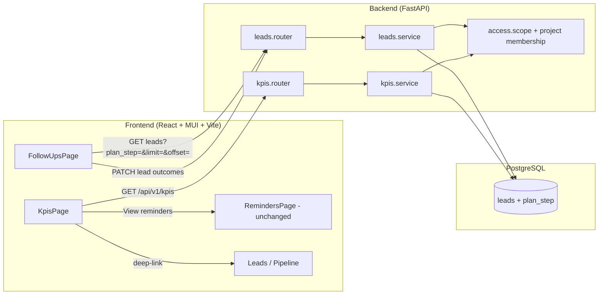
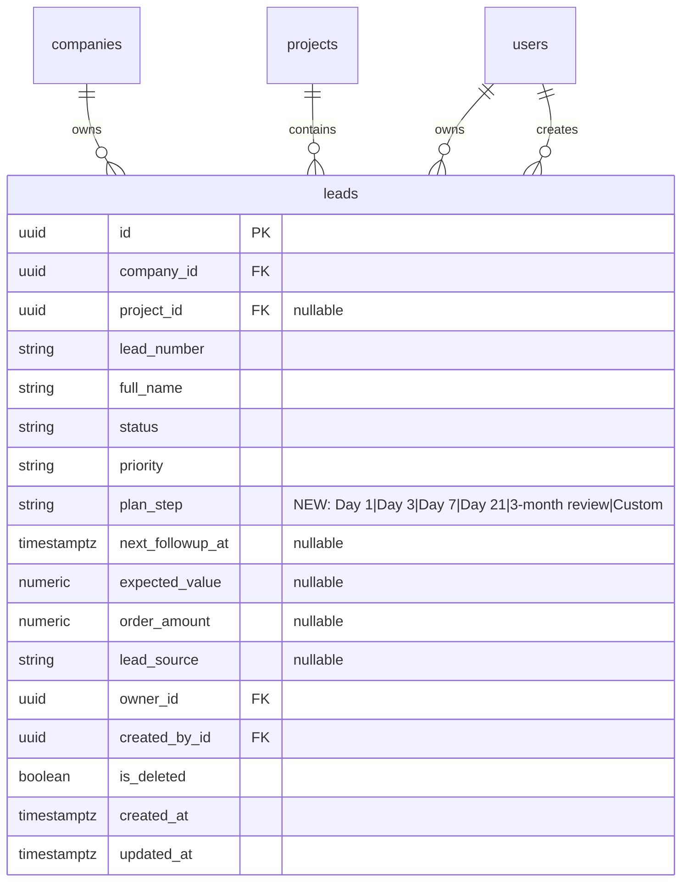

# Technical Design — Follow-ups + KPIs (Aadi CRM)

## 1. Design Summary

Ship working **Follow-ups** (`/app/follow-ups`) and **KPIs** (`/app/kpis`) by extending the existing leads stack—not by replacing Reminders or introducing a tasks microservice.

| Decision | Choice | Why |
|---|---|---|
| Plan step storage | New `leads.plan_step` column (`Day 1` \| `Day 3` \| `Day 7` \| `Day 21` \| `3-month review` \| `Custom`), default `Day 1` | Matches product reference filter; migrations `0012` + `0013` |
| Outcome persistence | Client composes `PATCH /api/v1/leads/{id}` (same pattern as Reminders) | Reuses audit, visibility, permissions; no new write API |
| Skip due clear | Allow explicit `next_followup_at: null` on PATCH | Current service rejects null; required for locked Skip rule (FR-F5) |
| KPI totals | New `GET /api/v1/kpis` server aggregate over same lead visibility scope | Correct totals beyond list page size; meets NFR-2 at ~5k leads |
| Won value | `COALESCE(order_amount, expected_value)` for Won rows | Locked product rule |
| UI | New `FollowUpsPage` + `KpisPage`; mark nav `ready: true` | Replace Coming-soon placeholders; keep Reminders untouched |

**Assumption:** MVP scale is tens of users per company and hundreds to low thousands of leads (stress target ~5k visible). Day boundaries for server due/overdue counts use **UTC calendar days**, matching existing `GET /api/v1/leads?next_followup_at=` behaviour; overdue **display** on Follow-ups uses the caller’s **local** calendar day (FR-F7 / existing `followWhen`).

---

## 2. Architecture Overview

Extend FastAPI + React/MUI in place. Follow-ups is a plan-step worklist over visible leads. KPIs is a read-only aggregate read model. Reminders stays the due-action queue.



**Component notes**

- **Shared visibility:** KPIs must call the same company / owner / salesperson-project filters as `list_leads` (extract a shared `_visible_lead_conditions(db, actor)` helper used by both list and aggregate).
- **SessionOutcomeTally:** React state only on FollowUpsPage; not persisted (FR-F6, NFR-6).
- **No new auth:** reuse session cookies + `require_permission("leads.read" | "leads.update")`.

---

## 3. Tech Stack Decisions

| Area | Choice | Why | Trade-off |
|---|---|---|---|
| Backend framework | Existing FastAPI app | Already hosts leads/RBAC | — |
| ORM / migrations | SQLAlchemy + Alembic (`0012_…`) | Matches repo pattern | Must keep migration reversible |
| Plan step type | `String(20)` + DB `CHECK` | Fixed MVP set; simple filters | Not per-project catalogues (out of scope) |
| KPI module | New `backend/app/kpis/` (`router`, `schemas`, `service`) | Keeps aggregate logic out of leads router; clear `/api/v1/kpis` | Small new package vs stuffing into leads |
| Visibility reuse | Shared conditions helper in `leads.service` (or thin `leads/visibility.py`) | Single source of truth for NFR-3 / FR-K8 / FR-F10 | Small refactor before KPI queries |
| Follow-ups writes | Existing `PATCH /api/v1/leads/{id}` | Same as Reminders; audit already records `lead_updated` | Outcome rules live in frontend (document + share helpers) |
| Clear due date | PATCH accepts explicit null for `next_followup_at` | Required for Skip | Create still requires a due; only clear-on-update changes |
| Frontend | React + MUI + Vite; reuse `PRIORITY_*`, `lead-dates`, `api` client | Theme / overdue / chips already exist (FR-S2, NFR-4) | Follow-ups actions differ in labels from Reminders (intentional) |
| Currency display | `en-IN` + `₹` (as PipelinePage) | FR-K9 | No FX |
| Client aggregate | Rejected for KPIs | Page-size caps would undercount | Extra endpoint to maintain |

---

## 4. Database Design

### ER (relevant slice)



No new tables. KPI snapshot and session tally are not stored.

### Migration `0012_lead_plan_step` (name illustrative)

**Revises:** `0011_company_profile_fields`

| Change | Detail |
|---|---|
| Add column | `plan_step VARCHAR(40) NOT NULL DEFAULT 'Day 1'` (`0012` then `0013` cadence rename) |
| Backfill | Demo rows spread across Day 1 / 3 / 7 / 21 / 3-month review / Custom |
| Check | `ck_leads_plan_step`: Day 1, Day 3, Day 7, Day 21, 3-month review, Custom |
| Index | `ix_leads_company_plan_step` on `(company_id, plan_step)` |
| Optional composite | `ix_leads_company_plan_step_due` on `(company_id, plan_step, next_followup_at)` for Follow-ups sort/filter |

**Rollback:** drop check, drop indexes, drop column.

### Model / constants (ORM)

```text
PLAN_STEPS = ("Day 1", "Day 3", "Day 7", "Day 21", "3-month review", "Custom")
```

Add `CheckConstraint` on `Lead` mirroring DB. Server default `'Day 1'` on create when omit.

### Multi-tenancy

Shared schema with `company_id` on leads (existing). Isolation enforced in every list/get/update/KPI query via `resolve_record_scope` + salesperson `project_ids_for_member` (existing). Never trust client-supplied company filters for scope.

### Follow-ups row eligibility (query semantics)

**Assumption (A10 locked intent):** Follow-ups list = non-deleted leads visible to caller, **exclude Lost** (and legacy `unqualified`), include others even when `next_followup_at` is null (nulls last). **Won** rows: include only if `next_followup_at` is not null (future or past); if Won and due is null, exclude.

Implement as optional list filters (see API) so Follow-ups does not invent a second list endpoint.

---

## 5. API Design

Base: existing `/api/v1/...`, envelope `{ "data": ..., "message": "..." }`, errors `{ "error": { "code", "message", "details?" } }`.

### 5.1 Extend lead schemas / list

| Change | Detail | Covers |
|---|---|---|
| `LeadPublic` | Add `plan_step: str`; add `order_amount: str \| null` (decimal string like `expected_value`) | FR-F2, FR-F3, FR-K3 |
| `CreateLeadRequest` | Optional `plan_step` defaulting to `Day 1` if omitted | FR-F3 |
| `UpdateLeadRequest` | Optional `plan_step`; `next_followup_at` may be **null to clear** when field is set | FR-F3, FR-F5 |
| `to_lead_public` | Map new fields | FR-F2 |
| `LeadFilters` + `GET /leads` | Query `plan_step`; optional `exclude_statuses` (comma list) **or** dedicated `for_followups=true` shorthand applying Lost/Won rules above | FR-F4, FR-F10, A10 |
| Sort for Follow-ups | When `for_followups=true` (or explicit `sort=followups`): `next_followup_at ASC NULLS LAST`, then priority rank, then `lead_number` | FR-F2, NFR-2 |

Prefer **`for_followups=true`** boolean over a free-form exclude DSL: one product rule in one place.

### 5.2 Lead update behaviour change (Skip enabler)

Today `update_lead` rejects `next_followup_at is None`. Change to:

- If `"next_followup_at" in model_fields_set` and value is `None` → set column null (clear).
- If omitted → unchanged.
- Create path still requires a due datetime.

No separate Skip endpoint.

### 5.3 Outcome PATCH payloads (client-composed; documented contract)

| Outcome | Fields patched | Covers |
|---|---|---|
| **Connected** | If status `new` → `contacted`. Advance Day 1→3→7→21→3-month review; Custom stays. Due days match next step (1/3/7/21/90/7). | FR-F5 |
| **No answer** | Append line `No answer` to `requirement` (same pattern as Reminders); `next_followup_at` +1 day | FR-F5 |
| **Snooze** | `next_followup_at` +1 day | FR-F5 |
| **Skip** | `next_followup_at: null` | FR-F5 |

Use existing `addDaysIso` helpers. Do not change Reminders labels/actions in this MVP.

### 5.4 Endpoint table

| Method | Path | Role / permission | Request | Response | Errors | Covers |
|---|---|---|---|---|---|---|
| GET | `/api/v1/leads` | `leads.read` | Query: existing + `plan_step?`, `for_followups?`, `limit`, `offset` | 200 `LeadListData` including `plan_step`, `order_amount` | 401, 403, 422 | FR-F2, FR-F4, FR-F10 |
| POST | `/api/v1/leads` | `leads.create` | body + optional `plan_step` | 201 `LeadPublic` | 401, 403, 409, 422 | FR-F3 |
| PATCH | `/api/v1/leads/{id}` | `leads.update` | partial incl. `plan_step`, nullable `next_followup_at` | 200 `LeadPublic` | 401, 403, 404, 422 | FR-F5, NFR-3 |
| GET | `/api/v1/leads/{id}` | `leads.read` | — | 200 includes `plan_step`, `order_amount` | 401, 403, 404 | FR-F3 |
| GET | `/api/v1/kpis` | `leads.read` | — (scope from actor only) | 200 `KpiOverview` (below) | 401, 403 | FR-K3…K5, FR-K8, NFR-2, NFR-3 |

### 5.5 `KpiOverview` response shape

```json
{
  "total_leads": 0,
  "new_leads": 0,
  "qualified": 0,
  "followups_due": 0,
  "won_deals": 0,
  "won_value": "0.00",
  "pipeline_value": "0.00",
  "overdue_reminders": 0,
  "stage_overview": [
    { "status": "new", "label": "New", "count": 0, "percent": 0.0 }
  ],
  "quick_pulse": {
    "due_today": 0,
    "overdue_followups": 0,
    "conversion_rate_percent": 0.0,
    "top_source": { "label": "—", "count": 0 }
  }
}
```

**Computation (single scoped base query: `is_deleted = false` + visibility):**

| Metric | Rule |
|---|---|
| Total leads | `COUNT(*)` |
| New / Qualified / Won deals | `COUNT` where status in mapped aliases (`new`/`New`, etc.) |
| Follow-ups due | `next_followup_at < start_of_tomorrow_utc` and `>= start_of_today_utc` **or** `< start_of_today_utc` (overdue ∪ today) |
| Overdue reminders | `next_followup_at < start_of_today_utc` |
| Won value | `SUM(COALESCE(order_amount, expected_value))` for Won; nulls as 0 in sum |
| Pipeline value | `SUM(expected_value)` where status not in Won/Lost/unqualified set |
| Stage overview | Counts for: new, contacted, in_progress, qualified, won, lost, nurture (+ percent of total; 0% if total 0) |
| Due today | due in today’s UTC window |
| Overdue follow-ups | same as overdue reminders |
| Conversion | `won_deals / total_leads * 100` (0 if total 0) |
| Top source | mode of non-null `lead_source`; if none → `label: "—"`, `count: 0` |

Implement with SQLAlchemy aggregates / conditional sums—**one or few queries**, no N+1, no loading all rows into Python for MVP (NFR-2).

### 5.6 Router registration

```text
app.include_router(kpis_router, prefix="/api/v1/kpis", tags=["KPIs"])
```

GET `""` on that router → `/api/v1/kpis`.

---

## 6. Security

| Control | Design |
|---|---|
| AuthN | Existing session / `get_current_user` |
| AuthZ | KPI + Follow-ups list: `leads.read`. Outcomes: `leads.update`. UI disables actions without permission; server still enforces (NFR-3, AC-F3) |
| Scope | Same as leads: company for owner; owner_id + assigned projects for salesperson; no cross-company leakage on KPI (AC-K4) |
| Validation | `plan_step` enum validation in Pydantic + DB check; monetary fields unchanged (≥ 0) |
| Skip clear | Only authenticated updater in scope; audit `lead_updated` with fields including `next_followup_at` |
| XSS | MUI text escaping; no HTML from requirement notes rendered as HTML |
| Secrets | None new |
| Rate limit | No new public auth surface; rely on existing app limits if any |
| Audit | Reuse `record_audit` on lead PATCH; KPI is read-only (no write audit) |

---

## 7. Scalability and Performance

**Assumption:** ≤5k visible leads per caller; tens of concurrent users per company (from brief).

| Concern | Approach |
|---|---|
| KPI load | Server-side aggregates + indexes on `company_id`, `status`, `next_followup_at`, `plan_step` |
| Follow-ups list | Paginate (`limit` default 50–100, max remains ≤500); filter `plan_step` / `for_followups` in SQL; do not client-aggregate 5k for KPIs |
| Bottleneck | DB aggregation/filter under company index — acceptable at 5k |
| Caching | None for MVP (live snapshot FR-K2); revisit if p95 > 3s |
| App tier | Stateless; horizontal scale unchanged |

**At 10x (~50k visible leads):** add covering indexes; consider materialized per-company KPI snapshot refreshed async; cursor pagination for Follow-ups; optional read replica for `GET /kpis`.

**NFR-1:** Follow-ups table desktop; stacked cards / drawer actions on `<md` (mirror Reminders). KPI cards: responsive CSS grid (1 / 2 / 4 columns).

**NFR-5:** loading / error+retry / empty copy on both pages.

---

## 8. Risks and Open Questions

### Risks

| Risk | Impact | Mitigation |
|---|---|---|
| Users confuse Follow-ups vs Reminders | Duplicate work | Distinct subtitle + step filter; do not rename Reminders |
| PATCH null for due surprises other clients | Accidental clear | Only clear when field **present** and null; document in OpenAPI; Leads forms omit field when unchanged |
| Status alias sprawl (`new` vs `New`) | Wrong KPI counts | Reuse `_STATUS_FILTER_VALUES` / `normalize_status` in KPI service |
| UTC vs local “today” mismatch | Due counts differ slightly from UI overdue colour | Document; KPI UTC; Follow-ups display local — accept for MVP |
| Client-composed Connected rules drift | Inconsistent with future mobile | Keep a single frontend helper module; optional later server outcome endpoint |
| Skip removes lead from Reminders | Rep confusion | Empty-state copy; due can be set again from Leads/Reminders |

### Open questions

**Product locks (2026-10-31) — closed; design follows these:**

1. Plan steps Day 1 / 3 / 7 / 21 / 3-month review / Custom; Connected advances along that cadence.
2. Skip clears `next_followup_at`.
3. Won value = `order_amount` if present else `expected_value`.

**Residual (non-blocking for MVP; defaults below):**

| # | Topic | Default for implementation |
|---|---|---|
| R1 | KPI “today” timezone | UTC (align leads list date filter) |
| R2 | Exact Follow-ups list helper | `for_followups=true` on GET leads |
| R3 | Expose `order_amount` on all lead reads | Yes (needed for transparency; Won value still server-side on KPIs) |

Nothing deferred from FR-F*, FR-K*, FR-S*, NFR-1…6 except out-of-scope items already excluded in the brief (campaigns, trends, tasks table, persisted session analytics).

---

## 9. Developer Task Breakdown

Ordered; each task lists dependencies and requirement IDs.

| ID | Task | Depends on | Covers |
|---|---|---|---|
| **T1** | Alembic `0012`+`0013`: add `plan_step`, Day cadence values, check, backfill, indexes; update `Lead` model | — | FR-F3 |
| **T2** | Extract shared visible-lead SQL conditions helper from `list_leads` (company, owner_ids, salesperson projects, `is_deleted`) | — | FR-F10, FR-K8, NFR-3 |
| **T3** | Extend schemas: `plan_step` on create/update/public; `order_amount` on public; Pydantic enum/literal validation | T1 | FR-F2, FR-F3, FR-K3 |
| **T4** | Service/router: create default `Day 1`; PATCH `plan_step`; **allow clear** `next_followup_at=null`; list filter `plan_step` + exclude_lost | T1, T2, T3 | FR-F3, FR-F4, FR-F5, FR-F10, A10 |
| **T5** | New `app/kpis` module: schemas + service aggregates + `GET /api/v1/kpis`; register in `main.py`; reuse T2 visibility | T2, T3 | FR-K3, FR-K4, FR-K5, FR-K8, FR-K9 (values), NFR-2, NFR-3 |
| **T6** | Frontend types: `plan_step`, `order_amount` on `Lead`; shared outcome helper (`applyFollowUpOutcome`) encoding Connected/No answer/Snooze/Skip rules | T3 | FR-F5, NFR-4, NFR-6 |
| **T7** | `FollowUpsPage`: header, session tally subtitle, step filter, responsive worklist, overdue styling, priority chips, row actions, loading/error/empty; wire list + PATCH | T4, T6 | FR-F1, FR-F2, FR-F4, FR-F5, FR-F6, FR-F7, FR-F8, FR-F9, FR-F10, NFR-1, NFR-4, NFR-5, NFR-6, US-F1…F4 |
| **T8** | `KpisPage`: 8 cards, stage overview bars, quick pulse, ₹ formatting, View pipeline / View reminders, card deep-links (Reminders for due/overdue; Leads/Pipeline for status/value; fallback Leads); loading/error/empty-zero states | T5 | FR-K1…K9, NFR-1, NFR-4, NFR-5, US-K1…K4 |
| **T9** | Routes: replace nav placeholders with real pages for `follow-ups` and `kpis`; set `ready: true` on `followUps` + `kpis` in `nav.ts` | T7, T8 | FR-F1, FR-K1, FR-S1 |
| **T10** | Visual polish: IBM Plex / primary `#1d4ed8` / slate surfaces; no purple demo chrome; match existing chip tones | T7, T8 | FR-S2, NFR-4 |
| **T11** | Automated/manual checks: scope isolation (two salespeople), Skip clears due, Connected advance +3/+7, KPI formulas, empty/error/retry, mobile layout smoke | T4, T5, T7–T10 | AC-F1…F5, AC-K1…K4, NFR-1…3 |

### Traceability matrix (FR / NFR → tasks)

| ID | Tasks |
|---|---|
| FR-F1 | T7, T9 |
| FR-F2 | T3, T4, T7 |
| FR-F3 | T1, T3, T4 |
| FR-F4 | T4, T7 |
| FR-F5 | T4, T6, T7 |
| FR-F6 | T7 |
| FR-F7 | T7 |
| FR-F8 | T7, T10 |
| FR-F9 | T7, T10 |
| FR-F10 | T2, T4, T7 |
| FR-K1 | T8, T9 |
| FR-K2 | T8 |
| FR-K3 | T3, T5, T8 |
| FR-K4 | T5, T8 |
| FR-K5 | T5, T8 |
| FR-K6 | T8 |
| FR-K7 | T8 |
| FR-K8 | T2, T5, T8 |
| FR-K9 | T5, T8 |
| FR-S1 | T9 |
| FR-S2 | T10 |
| NFR-1 | T7, T8, T11 |
| NFR-2 | T4, T5, T11 |
| NFR-3 | T2, T4, T5, T11 |
| NFR-4 | T6, T7, T8, T10 |
| NFR-5 | T7, T8 |
| NFR-6 | T6, T7 |

---

*End of Technical Design. Ready for implementation against `aaditech-auth`.*
